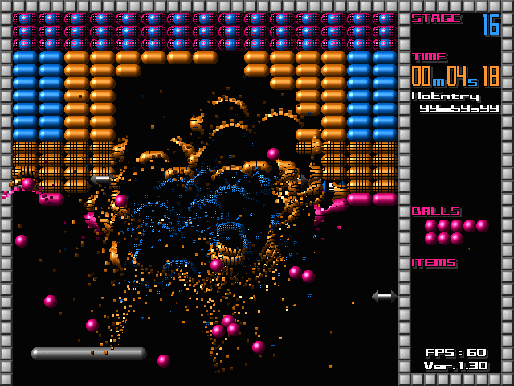
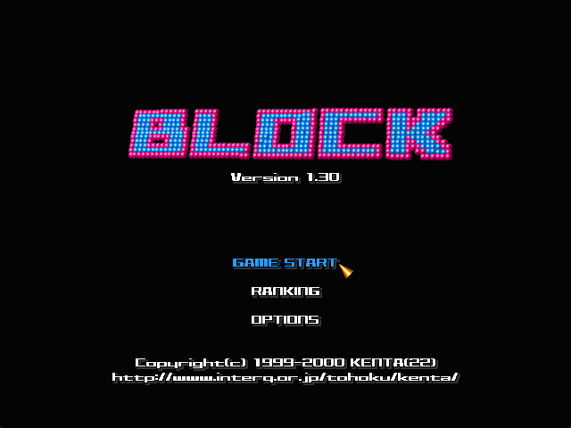
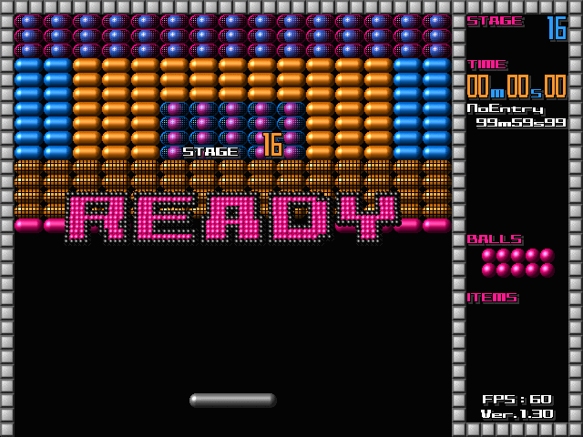
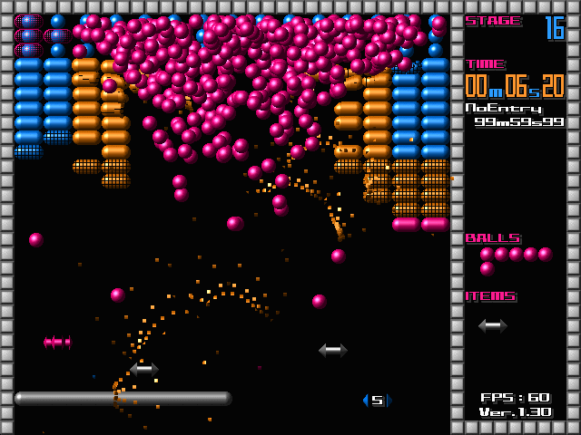
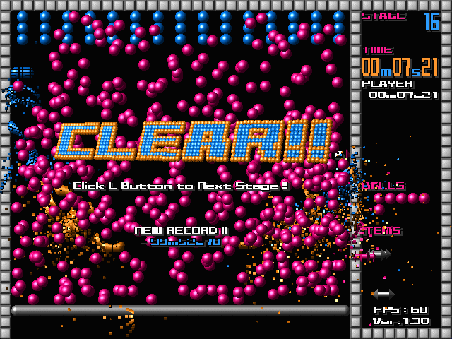

# BLOCK — source rebuild

A from-scratch C++23 / SDL3 rebuild of **BLOCK v1.30** (KENTA, 2000), a physics breakout game for
Windows 95/98/Me/2000. The original (`block130.exe`) needs exclusive 640x480 256-colour DirectDraw and does not
run properly on current Windows. This rebuild reproduces its game logic, constants and screens from the
decompiled binary.

**Version 1.50** adds replays of every stage's best time, split times against your best run, keyboard and
gamepad controls, custom stage packs, sharp and scanline display filters, and a single-file download with the
sounds built in. 1.40 added smooth motion at any refresh rate, borderless and full-screen modes, scaling options
and builds for macOS and Linux. The game itself plays exactly as before.

<p align="center">
  
</p>

## Screenshots

<p align="center">
  
  
  
  
</p>

## Download

From the Releases page:

| system | file | to run |
|---|---|---|
| Windows 10/11 | `BLOCK-1.5-win64.zip` | unzip anywhere and run `block.exe` |
| macOS 13.3+ (Apple silicon and Intel) | `BLOCK-1.5-macos.zip` | unzip and open `BLOCK.app` (see below) |
| Linux x86-64 | `BLOCK-1.5-linux-x86_64.tar.gz` | extract and run `block` |

No installer and no other downloads are needed: the graphics, stages and sounds are all inside the executable.

- **Windows:** the exe is not code-signed, so SmartScreen may warn on first run: *More info → Run anyway*.
- **macOS:** the app is not notarised, so the first time macOS refuses to open it. Open **System Settings →
  Privacy & Security** and click **Open Anyway** (or right-click the app → Open).
- **Linux:** built on Ubuntu 24.04, so it needs glibc 2.39 or newer. Sound and video libraries (ALSA,
  PulseAudio/PipeWire, X11/Wayland) are loaded at run time from the system.

## Building

Requires CMake 3.24+ and a C++23 compiler: Visual Studio 2022 or later on Windows, Xcode 16 on macOS, GCC 13
or Clang 17 on Linux. SDL3 is fetched automatically.

```
cmake -S . -B build -DCMAKE_BUILD_TYPE=Release
cmake --build build --config Release
ctest --test-dir build -C Release --output-on-failure
```

The result is `build/Release/block.exe` on Windows, `build/BLOCK.app` on macOS and `build/block` on Linux.
Everything in `assets/` is compiled in.

On Linux, SDL needs the development packages for the systems it supports; on Debian/Ubuntu see the list in
[.github/workflows/build.yml](.github/workflows/build.yml). For a universal macOS build add
`-DCMAKE_OSX_ARCHITECTURES="arm64;x86_64"`.

To make the release package for the current platform (`build/BLOCK-1.5-<platform>.zip` or `.tar.gz`):

```
cmake --build build --config Release --target package
```

Every push builds and tests all three platforms on GitHub Actions; pushing a `v*` tag also attaches the
packages to a draft release (see [.github/workflows/build.yml](.github/workflows/build.yml)).

### Tests

`block_tests` checks the save, settings, stage and replay formats, the deterministic maths, that every built-in
sound decodes to its original length, and split times. It also plays stages without a window: a simple bot
clears a stage while a replay records, and the replay must clear it again at the same millisecond. The
reference replays in `tests/data/` are played back on every platform in CI, which checks that the physics give
bit-identical results on Windows, macOS and Linux. After a deliberate change to the physics, record them again
with `block_tests --write-golden`.

## Playing

| mouse | keyboard | gamepad | action |
|---|---|---|---|
| move | arrows / WASD / numpad | left stick / d-pad | move the paddle (and the cursor in menus) |
| right button | X / Space | B / X / RB / RT | launch a ball (up to 10 per stage) |
| left button (hold) | Z / Enter (hold) | A (hold) | click; in play, pull the paddle down and release to flick the ball |
| | Esc / P (or any other key) | Start | pause / stage select (Esc or Start again resumes) |
| | Esc | Back | outside play: close the top window or go back a screen; on the title screen Esc quits |
| | F11 or Alt+Enter | | switch between window and full screen |

The mouse is captured while the window has focus, as the original owned the whole screen; Alt+Tab to leave.
Switching away pauses the game. Closing the window or pressing Esc on the title screen saves and quits.

In FREE MODE the pause key opens **STAGE SELECT**: pages of nine stage thumbnails. Click a stage to play it.

### Replays and split times

Each stage's best time is saved as a replay. On the **RANKING** screen, pick a stage under **STAGE TIME** and
choose **WATCH REPLAY**; click or press a key to stop watching. Replays are small (a few KB) and play back
exactly, on any computer, because the game logic is fully deterministic.

In time trial, the clear screen and the HUD show your **split**: how far ahead (blue, `-`) or behind (red, `+`)
your total time is compared with your best complete run at the same stage. The ending's result list shows the
split for every stage.

### Files

| file | contents |
|---|---|
| `block.ini` | all settings |
| `block.sav` | name, rankings, best-run splits and FREE MODE unlock, for every stage pack (plain text) |
| `replays/<pack>/stageNN.rep` | the replay of each stage's best time |

They are kept next to the executable if that folder is writable, as the original did; otherwise (and always on
macOS) in the per-user folder: `%APPDATA%\KENTA\BLOCK\`, `~/Library/Application Support/KENTA/BLOCK/` or
`~/.local/share/KENTA/BLOCK/`.

Saves from the original game or from 1.30/1.40 (`block130.sys` and `block130.dat`) are imported automatically
the first time 1.50 runs in the same folder; put them next to the executable (or in the per-user folder).
They are left untouched and can be deleted afterwards.

## Settings

**OPTIONS** on the title screen has the original's volume, data reset and broken-block settings, plus:

| setting | choices |
|---|---|
| ADJUST VOLUME | master (the original's), music and sound volumes |
| SCREEN SETTINGS → DISPLAY | window, borderless (full screen at desktop resolution), full screen (exclusive) |
| SCREEN SETTINGS → SCALING | pixel perfect (whole-number multiples), fit (largest 4:3), stretch |
| SCREEN SETTINGS → FILTER | sharp (hard pixels, evenly sized at any scale), nearest (plain hard pixels), scanlines (dark lines between rows, like a CRT; needs 2x or larger) |
| SCREEN SETTINGS → SIDE FRAME | fill the space around the 4:3 picture with the playfield's wall tiles, or leave it black |
| SCREEN SETTINGS → VSYNC | on, or off for the lowest latency |
| SCREEN SETTINGS → FPS LIMIT | none, 60, 120, 144, 165 or 240; with variable refresh (G-Sync/FreeSync), a limit a few fps under the monitor's maximum keeps it in range |
| SCREEN SETTINGS → SMOOTH MOTION | on: sprites move smoothly between the game's 60 Hz updates and the paddle follows the mouse at the display rate; off: classic 60 fps |
| CONTROLS | mouse speed and keyboard/gamepad speed, 0.25x to 4x each |

The game logic always runs at 60 updates per second, so physics and record times are the same at every refresh
rate and setting. The window reopens on the monitor and at the position it was last on.

## Custom stage packs

Put stage files in a `stages/` folder next to the executable (or in the per-user folder above). Each `.txt`
file is a pack of 1 to 50 stages; **MODE SELECT** then has a **STAGES** line to choose between the original
stages and your packs. Each pack has its own rankings, replays and splits, and FREE MODE is always available
for custom packs.

The format is plain text, 15 columns by 26 rows per stage:

```
# comments start with #
name MY FIRST PACK
stage 1
...............
..00700700700..
(26 rows in all)
stage 2
...
```

`.` is empty; `0`–`9` and `a`–`g` are the block types (see the top of `stage-format-example.txt`, which is the
original 50 stages and comes with the release). An optional `name` line sets the name shown in the game. If a
file has a mistake, the game says which line when it starts and skips that pack.

A `stages.txt` next to the executable, which replaced the built-in stages in 1.30/1.40, now shows up as a pack
called `STAGES.TXT`.

### Custom sounds

The original game shipped without sounds and played whatever `.wav` files it found in its `wave/` folder. The
rebuild has the sounds built in, but a `.wav` or `.ogg` with one of the original names (`bgm`, `ball`,
`block`, … see `original/wave/readme.txt`) in a `wave/` folder next to the executable still replaces that sound.

## Differences from the original

Deliberate changes, everything else follows the original including its quirks:

- Game logic runs at a fixed 60 ticks per second (the original scaled by the measured frame rate, which made
  e.g. the cyan block's ball fountain depend on the monitor refresh rate). Drawing runs at the display rate,
  placing moving sprites between ticks.
- Stage timers advance in 16/17 ms steps counted from the start of the stage, and the physics use their own
  sine, cosine and arccosine, so a stage plays out identically from a replay on any computer.
- Menu items act once per click; the original repeated them while the button was held.
- When the 500-ball cap is reached, the cyan blocks' ball fountains share the free slots in turn. The
  original always gave them to the earliest-broken blocks, so later fountains never fired (most visible on
  stages 16 and 40).
- Saves are in `block.sav` and `block.ini` instead of `block130.sys` / `block130.dat`, after each stage clear
  and setting change as well as on exit. RESET YOUR DATA also deletes the replays, and keeps the settings.
- Keyboard and gamepad controls; the original used the mouse only and paused on any key. Esc pauses instead
  of quitting, except on the title screen.
- FREE MODE's STAGE SELECT shows nine stages per page as thumbnails; the original showed one large preview
  with PREVIOUS / NEXT / GOTO THIS STAGE.
- The game pauses when its window loses focus; the original kept running.
- The HUD's `FPS` shows the frames per second actually displayed.
- The version shown in the game is 1.50.

## Repository layout

| path | contents |
|---|---|
| `src/` | the rebuild |
| `tests/` | `block_tests` and its reference replays |
| `assets/` | sprite sheet, stage data, icons and sounds (Ogg Vorbis), made from the original by `re/convert_assets.py` and `re/encode_sounds.py` |
| `third_party/` | stb_vorbis, the Ogg Vorbis decoder |
| `cmake/embed.cmake` | compiles `assets/` into the executable |
| `.github/workflows/` | Windows, macOS and Linux builds and tests; release packages on tags |
| `re/` | reverse-engineering notes (`NOTES.md`, `notes/`), Ghidra decompile (`game.c`) and tooling |
| `shim/` | an earlier experiment: a hook DLL that forces the original exe into windowed mode |
| `docs/screenshots/` | the screenshots in this readme (native 640x480 frames) |
| `original/` | the original `block130.exe`, its Japanese readme (`README.TXT` is Shift-JIS; `README.utf8.txt` is a UTF-8 copy) and its sounds as wav (`wave/`) |
